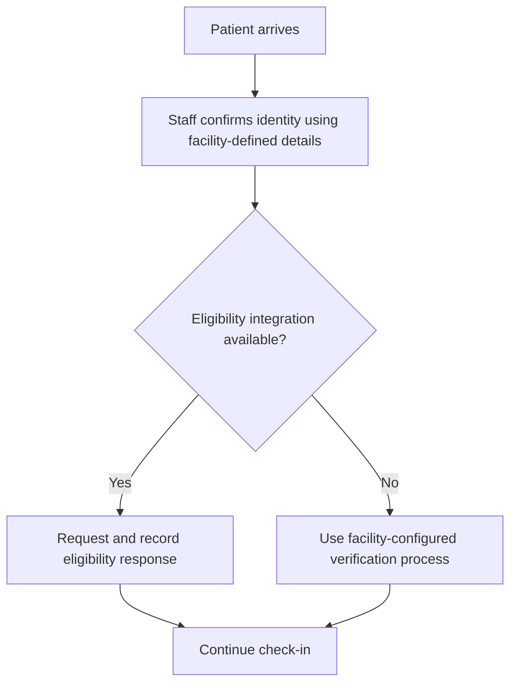

# Healthcare Check-In and Check-Out Requirements

**Project type:** Academic systems analysis and requirements documentation  
**Scenario:** Millennia HealthCenter, a fictional healthcare organization

## Project overview

I analyzed patient check-in and check-out workflows and documented them through four UML use-case diagrams and four detailed use-case specifications. The specifications describe actors, preconditions, main steps, alternate paths, and outcomes so that a development team could understand how each workflow should behave.

The work focuses on making operational details explicit, including how staff confirm a patient’s identity, record insurance information, collect copays, and handle partial payments.

## Design considerations

- The proposed insurance eligibility service is conditional on the integration being available. The check-in flow accounts for how staff proceed if it is unavailable.
- The specifications distinguish recording a copay from processing a payment.
- Alternate flows document exceptions and incomplete steps instead of assuming every patient follows the same path.
- The diagrams and written specifications use consistent actors and terminology.

## What this demonstrates

Requirements analysis · UML use-case modeling · Workflow documentation · Exception handling · Stakeholder-focused communication · Systems analysis

## Project limits

This is an academic design exercise for a fictional health center. It does not describe a deployed system and contains no real patient information.

## Illustrative check-in workflow

This simplified workflow excerpt shows how the proposed eligibility check depends on whether an integration is available. It is a portfolio illustration, not a copy of the full submitted diagrams.

